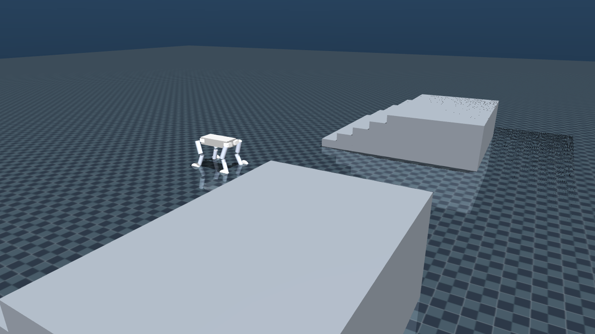
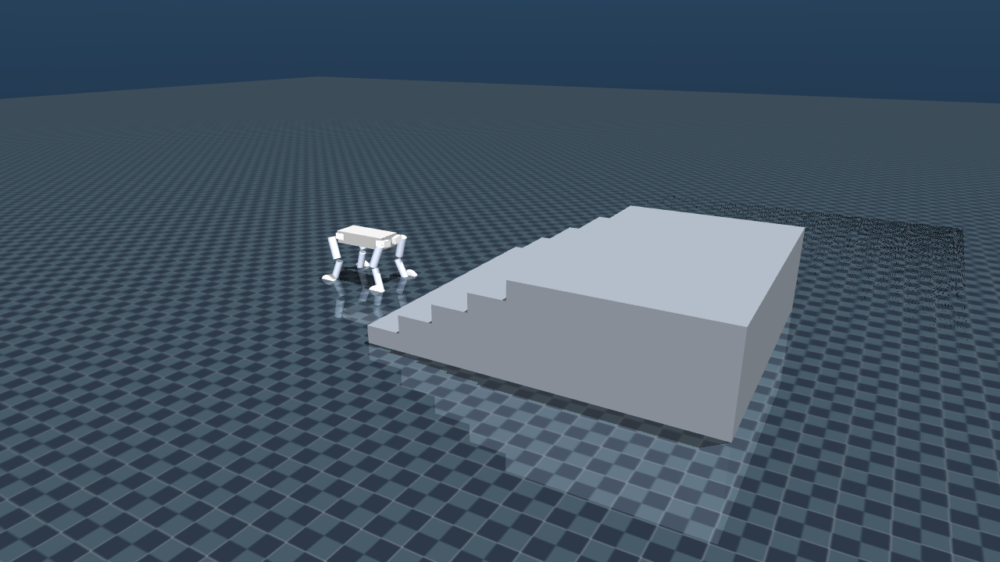
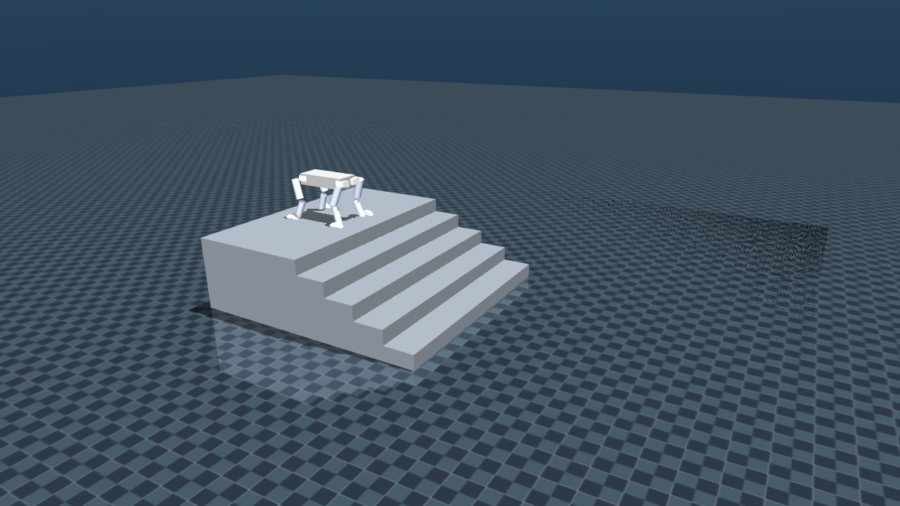
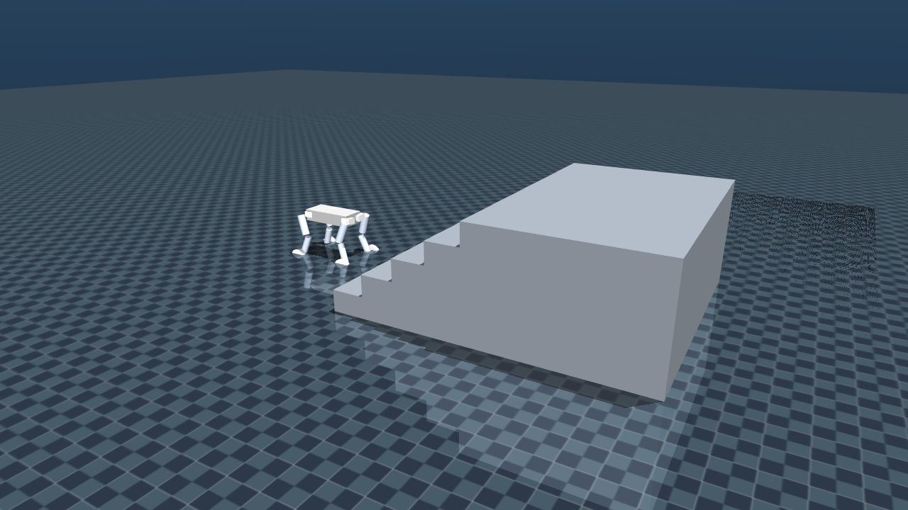
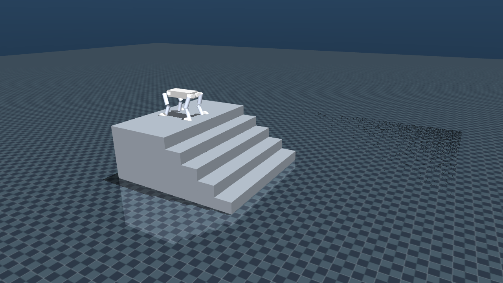

# WheeledDogV2

自研**轮足四足机器人**运动强化学习 **第一版（稳定上楼梯）**：Isaac Lab / Isaac Sim **5.1** 粗糙地形 + 楼梯课程训练，**MuJoCo** sim2sim 部署与可视化；仓库含 URDF、训练任务配置、15/20 cm 楼梯场景与 **预训练权重**。

> Custom wheeled-legged dog RL **v1.0** (stable stair climbing): Isaac Lab 5.1 rough/stair training + MuJoCo sim2sim. Includes URDF, task configs, 15/20 cm stair scenes, and a pretrained checkpoint.

<p align="center">
  
</p>

| | |
|---|---|
| **作者 / Maintainer** | [liu-big](https://github.com/liu-big) · `2715209705@qq.com` |
| **仓库** | https://github.com/liu-big/WheeledDogV2 |
| **版本** | **v1.0** — 稳定上楼梯基线（锁轮点足爬楼） |
| **机器人** | WheeledDogV2 · 12 腿关节 + 4 驱动轮 |
| **训练任务** | `Rough-Wheeled-Dog-V2-v0` / `Flat-Wheeled-Dog-V2-v0` |
| **观测 / 动作** | obs **57** · act **16**（12 腿位置 + 4 轮速度） |
| **推荐权重** | [`checkpoints/model_38700.pt`](checkpoints/model_38700.pt) |

---

## 目录

1. [本版本说明](#本版本说明)
2. [仓库结构](#仓库结构)
3. [机器人与 URDF](#机器人与-urdf)
4. [环境依赖](#环境依赖)
5. [快速开始（仅 MuJoCo，推荐）](#快速开始仅-mujoco推荐)
6. [训练（Isaac Lab）](#训练isaac-lab)
7. [Isaac 侧播放](#isaac-侧播放)
8. [Rough 课程与关键配置](#rough-课程与关键配置)
9. [MuJoCo 键位与场景](#mujoco-键位与场景)
10. [常见问题](#常见问题)
11. [许可与致谢](#许可与致谢)
12. [引用](#引用)

---

## 本版本说明

**v1.0 目标**：在仿真中稳定完成 **15 cm / 20 cm** 楼梯上下，作为轮足狗 RL 的第一个可复现基线。

已验证能力概览：

- SolidWorks → URDF 自研机型接入 DeepRobotics `rl_training` + RSL-RL PPO
- Rough 地形课程（含金字塔楼梯）；对称相关奖励减轻直行偏航
- 默认 **锁轮当足** 点足爬楼；可选解锁轮速动作
- MuJoCo 与训练观测/动作维度对齐，可直接加载 `model_38700.pt` 遥控测试

> 本仓库**不包含** Isaac Sim / Isaac Lab 安装包与完整训练日志（体积大）。请自行安装仿真环境；仅做 MuJoCo 部署时可不装 Isaac。

---

## 仓库结构

```text
WheeledDogV2/
├── assets/WheeledDogV2/           # 机器人资源（推荐从此读 URDF）
│   ├── urdf/wheeled_dog_v2.urdf   # Isaac 训练用 URDF
│   ├── meshes/*.STL               # 视觉网格
│   └── mjcf/                      # 可选 MJCF
├── checkpoints/
│   ├── model_38700.pt             # v1.0 推荐策略权重
│   └── README.md
├── sim2sim_wheeldog/              # MuJoCo 部署 / 楼梯可视化
│   ├── wheeldog.xml
│   ├── scenes/                    # 15cm / 20cm 上下楼
│   ├── run_policy_wheeldog.py     # 加载策略 + 小键盘遥控
│   └── view_stairs.py
├── rl_training/                   # DeepRobotics rl_training（含本机任务）
│   ├── deep_robotics_model/WheeledDogV2 -> ../../assets/WheeledDogV2
│   └── source/rl_training/.../wheeled_dog_v2/
├── train_wheeled_dog_v2.sh        # 训练入口
├── play_wheeled_dog_v2.sh         # Isaac 侧 play
└── docs/images/                   # 楼梯场景截图
```

---

## 机器人与 URDF

### 命名约定（SolidWorks 导出）

| 缩写 | 含义 | 关节名示例 | 控制 |
|------|------|------------|------|
| H1 | 髋 roll（外展） | `FL_H1_L_j1` | 位置 |
| H2 | 髋 pitch | `FL_H2_L_j2` | 位置 |
| K  | 膝关节 | `FL_K_L_j3` | 位置 |
| W  | 轮 | `FL_W_L_j4` | 速度 |

腿序：`FL / FR / RL / RR`。Link：`base_link` + 每腿 `H1/H2/K/W`。

### 主要文件

| 文件 | 用途 |
|------|------|
| [`assets/WheeledDogV2/urdf/wheeled_dog_v2.urdf`](assets/WheeledDogV2/urdf/wheeled_dog_v2.urdf) | **主 URDF**（惯性来自 SolidWorks；visual=STL；collision=box/cylinder） |
| `assets/WheeledDogV2/meshes/*.STL` | 视觉网格 |
| `sim2sim_wheeldog/wheeldog.xml` | MuJoCo MJCF（部署） |
| `sim2sim_wheeldog/wheeldog_vis.urdf` | MuJoCo 可视化 URDF |

### 默认站立姿态（内八，与训练 `init_state` 一致）

| 关节 | FL | FR | RL | RR |
|------|----|----|----|-----|
| H1 | +0.12 | −0.12 | −0.12 | +0.12 |
| H2 | +0.35 | −0.35 | −0.35 | +0.35 |
| K  | +0.70 | −0.70 | −0.70 | +0.70 |
| W  | 0 | 0 | 0 | 0 |

根高度约 **0.55–0.58 m**。

### 执行器（Isaac `WHEELED_DOG_V2_CFG`）

| 组 | 关节 | effort | vel | stiffness | damping |
|----|------|--------|-----|-----------|---------|
| leg | H1 / H2 / K | 60 | 20 | 80 | 2 |
| wheel | W | 14 | 100 | 0 | 0.6 |

动作缩放：H1=`0.125`，其余腿=`0.25`，轮速 scale=`5.0`。

---

## 环境依赖

### 硬件建议

- NVIDIA GPU（训练示例：4096 parallel envs）
- Linux + 桌面显示（GUI 训练 / MuJoCo viewer）

### 软件版本（本仓库验证）

| 组件 | 版本 |
|------|------|
| Isaac Sim | **5.1.0** |
| Isaac Lab | **2.3.x**（随 5.1） |
| conda | `isaaclab51` · **Python 3.11**（训练） |
| MuJoCo 部署 | 含 `mujoco` + `torch` 的环境即可（本机常用 conda `isaaclab`） |
| PyTorch | 训练侧建议保持 Isaac Sim 自带 CUDA 版，勿被 pip 误升级 |
| rsl-rl-lib | ≥ 5.0.1 |

### 安装概要（训练）

1. 安装 [Isaac Sim 5.1](https://docs.isaacsim.omniverse.nvidia.com/)（常见路径 `~/isaacsim`）。
2. 安装 / 链接 Isaac Lab 到上述 Isaac Sim。
3. 安装本仓库 `rl_training`：

```bash
git clone git@github.com:liu-big/WheeledDogV2.git
cd WheeledDogV2
conda activate isaaclab51
cd rl_training
pip install -e source/rl_training
```

4. 将 Isaac Lab 放到本仓库旁，或设置：

```bash
export ISAACLAB_ROOT=/path/to/IsaacLab
export CONDA_SH=$HOME/miniconda3/etc/profile.d/conda.sh
export CONDA_ENV=isaaclab51
```

`train_wheeled_dog_v2.sh` / `play_wheeled_dog_v2.sh` 会 `source "$ISAACLAB_ROOT/_isaac_sim/setup_conda_env.sh"`。

### 仅 MuJoCo 部署

```bash
# 任选已装 mujoco、torch、numpy 的 Python 环境
pip install mujoco torch numpy
```

---

## 快速开始（仅 MuJoCo，推荐）

无需 Isaac，直接验证 v1.0 权重：

```bash
cd WheeledDogV2/sim2sim_wheeldog

# 默认加载 ../checkpoints/model_38700.pt
python run_policy_wheeldog.py --scene 15up
python run_policy_wheeldog.py --scene 20up
python run_policy_wheeldog.py --scene 15down
python run_policy_wheeldog.py --scene 20down

# 或显式指定权重
python run_policy_wheeldog.py --scene 20up --ckpt ../checkpoints/model_38700.pt
```

默认：**锁轮站立**；指令为 0 时不瞎跑。小键盘 `8` 前进开始爬楼。

场景截图：

| 15 cm 上 | 15 cm 下 | 20 cm 上 | 20 cm 下 |
|----------|----------|----------|----------|
|  |  |  |  |

---

## 训练（Isaac Lab）

任务已注册：

- `Rough-Wheeled-Dog-V2-v0` — rough + 楼梯课程（**默认**）
- `Flat-Wheeled-Dog-V2-v0` — 平地

```bash
cd /path/to/WheeledDogV2

# 冒烟
MAX_ITERS=1 NUM_ENVS=4 GUI=0 bash train_wheeled_dog_v2.sh --max_iterations 1

# 完整 rough（GUI + 4096）
NUM_ENVS=4096 GUI=1 bash train_wheeled_dog_v2.sh

# 无头
GUI=0 NUM_ENVS=4096 bash train_wheeled_dog_v2.sh

# 从已有 run 续训
RESUME=1 LOAD_RUN=<run_dir_name> CHECKPOINT=model_xxxx.pt \
  NUM_ENVS=4096 GUI=1 bash train_wheeled_dog_v2.sh
```

常用环境变量：

| 变量 | 含义 | 默认 |
|------|------|------|
| `TASK` | 任务 ID | `Rough-Wheeled-Dog-V2-v0` |
| `NUM_ENVS` | 并行环境数 | `4096` |
| `GUI` | `1` GUI / `0` headless | `1` |
| `MAX_ITERS` | 最大迭代（空则用 cfg） | 空 |
| `RESUME` | `1` 续训 | `0` |
| `LOAD_RUN` | run 目录名 | 空 |
| `CHECKPOINT` | 如 `model_38700.pt` | 空 |
| `ISAACLAB_ROOT` | Isaac Lab 根目录 | `$ROOT/IsaacLab` |
| `CONDA_ENV` | conda 环境名 | `isaaclab51` |

日志目录：`rl_training/logs/rsl_rl/wheeled_dog_v2_rough/<timestamp>/`。

---

## Isaac 侧播放

```bash
cd /path/to/WheeledDogV2

# 默认加载 logs 下最新 run
NUM_ENVS=1 GUI=1 bash play_wheeled_dog_v2.sh

# 指定 run / ckpt（将权重放到对应 logs 目录后）
RUN_DIR=logs/rsl_rl/wheeled_dog_v2_rough/<run> CKPT=model_38700.pt \
  bash play_wheeled_dog_v2.sh
```

快速验证仓库权重：可先拷贝到日志结构再 play，或优先用 MuJoCo `run_policy_wheeldog.py`。

---

## Rough 课程与关键配置

与 `rough_env_cfg.py` 一致的要点：

- 地形：`pyramid_stairs` / `pyramid_stairs_inv` 各约 **35%**，台阶高度约 **2–20 cm**，踏步宽约 **0.30 m**
- `max_init_terrain_level` 偏低，降低开局难度
- 跟踪奖励偏强：`track_lin_vel_xy_exp`、`track_ang_vel_z_exp`
- 姿态惩罚放宽以利于爬楼；对称相关项（如 `joint_mirror` 等）改善直行
- 指令范围示例：`vx∈[-1.5,1.5]`，`vy∈[-0.6,0.6]`，`yaw∈[-1.0,1.0]`

关键源码：

| 内容 | 路径 |
|------|------|
| 资产 `WHEELED_DOG_V2_CFG` | `rl_training/source/rl_training/rl_training/assets/deeprobotics.py` |
| Rough 环境 | `.../config/wheeled/wheeled_dog_v2/rough_env_cfg.py` |
| Flat 环境 | `.../config/wheeled/wheeled_dog_v2/flat_env_cfg.py` |
| PPO | `.../wheeled_dog_v2/agents/rsl_rl_ppo_cfg.py` |
| 指令 / knee 回退 | `.../velocity/mdp/commands.py` |

---

## MuJoCo 键位与场景

```bash
cd sim2sim_wheeldog
python run_policy_wheeldog.py --scene <name> [--ckpt PATH]
# <name>: 15up | 15down | 20up | 20down | all
```

| 键 | 作用 |
|----|------|
| 8 / 2 | 前进 / 后退 |
| 4 / 6 | 左转 / 右转 |
| 7 / 9 | 左移 / 右移 |
| 0 / 5 | 停止（指令清零 → 站立） |
| L / U | 锁轮 / 解锁轮 |
| R | 重置 |
| P | 暂停 |

默认行为：

- 指令为 0 → 站立，不跑策略乱步
- **锁轮**当足；策略驱动 12 腿；`U` 后才接上轮速动作
- 观测 57 / 动作 16，与训练契约一致
- 下楼场景从平台 keyframe `spawn` 起步

仅看地形：

```bash
python view_stairs.py
```

---

## 常见问题

**Q: 训练脚本找不到 `setup_conda_env.sh`？**  
设置 `ISAACLAB_ROOT` 指向本机 Isaac Lab 安装目录。

**Q: MuJoCo 里一动就歪 / 摔倒？**  
确认加载的是 `checkpoints/model_38700.pt`；先锁轮（`L`），小指令爬楼；检查场景是否与测试意图一致（上/下）。

**Q: 能否只下载权重测楼梯？**  
可以。克隆仓库后只跑 `sim2sim_wheeldog/run_policy_wheeldog.py` 即可。

**Q: 续训应从哪个权重开始？**  
发布权重为 `model_38700.pt`。续训时请把该文件放入对应 `logs/.../<run>/`，再用 `RESUME=1 LOAD_RUN=... CHECKPOINT=model_38700.pt`。

**Q: 贡献者？**  
本项目维护者仅为 **liu-big**（`2715209705@qq.com`）。欢迎 Issue 讨论；合并以作者审核为准。

---

## 许可与致谢

- 本仓库中 **WheeledDogV2 URDF / meshes / sim2sim 脚本 / 任务配置 / 发布权重** 由 [liu-big](https://github.com/liu-big) 维护。
- `rl_training` 框架与部分资产管线来自 [Deep Robotics](https://www.deeprobotics.cn/) 开源训练栈，见 `rl_training/LICENSE`、`LICENSE-robot_lab`。
- 仿真依赖 NVIDIA Isaac Sim / Isaac Lab 与 MuJoCo，请遵守各自许可。

---

## 引用

```text
liu-big. WheeledDogV2: Isaac Lab training and MuJoCo sim2sim for a wheeled-legged dog (v1.0 stable stair climbing).
https://github.com/liu-big/WheeledDogV2
Contact: 2715209705@qq.com
```

若本仓库对你有帮助，欢迎 Star。
